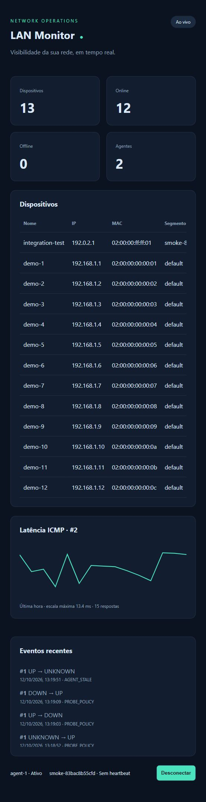

# LAN Monitor

Hub de monitoramento de LAN com **Python/Scapy**, **Java 21/Spring Boot**, **MySQL 8.4**, **React** e **Docker Compose**. Descobre MAC/IP, registra latência ICMP/DNS e transmite estados UP/DOWN/UNKNOWN via SSE.

## Executar a demonstração

Pré-requisito: Docker com Compose v2. Não é necessário instalar Java/Python/Node no host para subir a aplicação.

```sh
cp .env.example .env
# Edite .env e substitua as três credenciais por valores aleatórios.
docker compose up -d --build
```

No PowerShell, use `Copy-Item .env.example .env` no lugar de `cp` se preferir.

Abra [http://localhost:3000](http://localhost:3000) e informe `AGENT_TOKEN`. O modo padrão simula 12 dispositivos; selecione uma linha para consultar a latência. Backend disponível somente em localhost:8080; MySQL não publica porta no host.

## Monitorar uma LAN real

Utilize Docker Engine em host Linux conectado ao segmento monitorado. Configure `LAN_INTERFACE`, `LAN_CIDR` e `DNS_RESOLVER` no `.env`.

```sh
docker compose -f compose.yaml -f compose.linux.yaml up -d --build
```

O agente usa rede do host e somente a capability NET_RAW. ARP não atravessa roteadores: use um agente por VLAN/segmento. Docker Desktop/WSL exige validação de acesso à camada 2; a demonstração sintética funciona sem essa dependência. O modo raw atualmente descobre IPv4, com sub-redes limitadas a 4.096 endereços.

## Arquitetura e dados

```text
LAN → Scapy → SQLite spool → HTTP batch → Spring/JDBC → MySQL
                                           └ após commit → SSE → React
```

As migrations Flyway ficam em `backend/src/main/resources/db/migration`. Cadastro por segmento/MAC, IP binário, latência em microssegundos, deduplicação por agente/UUID e eventos de transição. Tabelas temporais particionadas por mês; manutenção cria partições futuras e calcula agregados de um minuto. Sem FKs nas tabelas particionadas, conforme restrições do MySQL.

Endpoints autenticados por `Authorization: Bearer <AGENT_TOKEN>`:

| Método | Endpoint | Uso |
|---|---|---|
| POST | `/api/v1/telemetry/batches` | Lote com até 1.000 amostras; commit antes do ACK |
| GET | `/api/v1/snapshot` | Dispositivos, agentes e últimos 50 eventos |
| GET | `/api/v1/stream` | SSE; snapshot inicial e atualizações |
| GET | `/api/v1/devices/{id}/latency` | Última hora, até 500 registros |
| GET | `/actuator/health` | Saúde do backend |

O token é compartilhado nesta versão e permite leitura/escrita. Para exposição externa, implementar autenticação de operador separada, credenciais por agente e TLS. O frontend mantém o token somente em memória.

## Verificação

```sh
PYTHONPATH=agent/src python -m unittest discover -s agent/tests -v
export AGENT_TOKEN='<mesmo valor do .env>'
python scripts/smoke.py
```

PowerShell: `$env:PYTHONPATH='agent/src'` e `$env:AGENT_TOKEN='<valor>'`, depois execute os comandos Python.

O smoke test exige a stack em execução e grava dispositivos no segmento `smoke-<id>`; executar em banco descartável. Ele verifica transações de ingestão, deduplicação, conflito de payload, UP/DOWN, histórico, autenticação e primeiro snapshot SSE.

**Verificação em 12/10/2026:** stack real iniciada no Docker Desktop/WSL 2; builds Java 21 e React concluídos, duas migrations MySQL aplicadas, três testes Python aprovados e smoke test aprovado (ingestão, replay, conflito, UP/DOWN, histórico, autenticação e SSE). Dashboard verificado no navegador com 12 dispositivos simulados e gráfico de latência; ausência de heartbeat do agente de teste gerou UNKNOWN. Coleta ARP em LAN real ainda não foi validada.



## Benchmarks reproduzíveis

```sh
python benchmarks/ingestion.py --batches 100 --size 200 --workers 4
```

Usar banco descartável. Resultado em `benchmarks/results/latest.json`: samples/s, duração, média, p95 e p99 de ingestão. Publicar junto de CPU, RAM, SSD, versões e métricas de `docker stats`. Nenhum resultado de desempenho foi inventado. 1.000 dispositivos a cada 5s equivalem a 200 amostras/s e 17,28 milhões/dia para uma sonda por dispositivo.

## Organização

```text
agent/         Coleta Scapy, transporte HTTP, spool e testes
backend/       Spring Boot, JDBC, streaming, migrations e manutenção
dashboard/     React, gráfico SVG, tabela e timeline
contracts/     JSON Schema de ingestão
infra/mysql/   Configuração de durabilidade
scripts/       Smoke test de integração
benchmarks/    Gerador de carga e relatórios
docs/          Arquitetura, operação, roadmap e checklist
.github/       CI, publicação GHCR, deploy manual e Dependabot
```

Consulte [arquitetura](docs/architecture.md), [roadmap de cinco sprints](docs/roadmap.md), [checklist](docs/engineering-checklist.md) e [operação/backup](docs/operations.md).

Esta é a primeira versão de processo único. Antes de escalar, resolver filas de clientes SSE, custo dos rollups, autenticação por agente, lockfile do frontend e testes de carga/rede real. Os critérios pendentes estão documentados no checklist.
