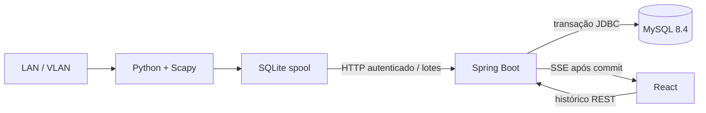

# Arquitetura

Um processo backend e um agente proprietário por segmento. ARP está restrito ao domínio de broadcast local. Identidade = segmento + MAC, sem unicidade de IP. Telemetria particionada não usa foreign keys: a transação valida/cria o cadastro antes das amostras. Chaves primárias contêm a coluna temporal.

O agente mantém dispositivos previamente descobertos para continuar verificando hosts que desapareceram do ARP scan. ICMP falhando com ARP respondendo mantém UP; três falhas consecutivas de ambas as sondagens produzem DOWN. DNS não determina disponibilidade. Sem heartbeat por 30 segundos: UNKNOWN, com evento AGENT_STALE. Observações atrasadas permanecem no histórico, sem atualizar estado se anteriores à última observação.

O backend serializa ingestão, snapshot e registro do stream nesta versão de processo único. Cada nova conexão SSE recebe um snapshot completo; cada commit relevante e heartbeat publica outro snapshot. Reconexão não depende de replay de eventos em memória. A interface usa fetch streaming para enviar o token no header, sem expor credenciais na URL.

Limites atuais: 100 streams, 1.000 amostras/lote, janela de replay de 24h, relógios UTC sincronizados. SSE usa escrita síncrona; em escala, migrar para filas por cliente, executor limitado e política de desconexão de clientes lentos. Para múltiplos backends, substituir monitor local por coordenação/distribuição de eventos e concorrência no banco.

SQLite retém até 10.000 lotes. Ao atingir o limite, coleta pausa; uploads continuam tentando drenar a fila. Dados mais antigos que 23h são descartados com log para respeitar a janela do servidor. Coleta e uploads usam um loop: timeout de envio pode atrasar a cadência. Não há garantia de intervalo exato sob falhas ou grandes redes.

Retenção por partições mensais: raw por pelo menos 30 dias (pode exceder até um mês), eventos/rollups por aproximadamente 12 meses. Manutenção cria partições futuras e remove somente partições inteiramente vencidas. Rollups recalculam 25h a cada minuto: correto para replay, mas pode custar caro em grandes volumes; avaliar implementação incremental antes de escalar.
